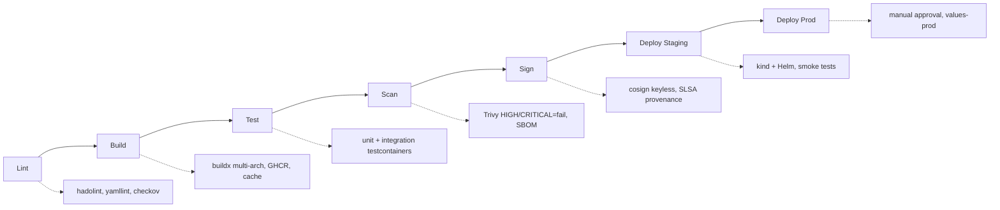

# Guía de presentación del proyecto final

## Formato y tiempo

| Componente | Tiempo | Formato |
|------------|--------|---------|
| **Presentación** | 10 min | Slides (PDF/Google Slides/Keynote) |
| **Demo en vivo** | 5 min | Terminal + navegador |
| **Q&A** | 5 min | Preguntas audiencia |
| **Total** | **20 min** | Estricto |

---

## Estructura de slides (10-12 slides)

### Slide 1: Portada (30 seg)
- Título: "TaskFlow - Docker Fundamentals Final Project"
- Tu nombre + rol
- Fecha
- Link repo GitHub + QR code

### Slide 2: Problema y objetivo (1 min)
- Qué resuelve TaskFlow (Kanban colaborativo + async processing)
- Objetivo del curso: stack production-ready end-to-end
- Métricas objetivo: build < 2min, deploy < 5min, MTTR < 30min

### Slide 3: Arquitectura - C4 Context (1 min)
- Diagrama C4 nivel 1 (contexto)
- Actores: Usuario, Admin, CI/CD, Observabilidad
- Sistemas: Frontend, API, Worker, PostgreSQL, Redis
- Sistemas externos: GitHub, Registry, Monitoring

### Slide 4: Arquitectura - C4 Container (1 min)
- Diagrama C4 nivel 2 (contenedores)
- 6 contenedores + 2 BD + observabilidad
- Protocolos: HTTPS/REST, SQL, Redis, WebSocket
- Flujo request: User → Frontend → API → DB/Redis

### Slide 5: Decisiones clave - ADR 002 Hardening (1 min)
- Nivel L2 elegido: non-root, read-only, cap_drop ALL, healthcheck
- Trade-off: seguridad vs debuggability (mitigado con observabilidad)
- Resultado: 0 HIGH/CRITICAL vulns, dive >92%, imagen < 180MB

### Slide 6: Decisiones clave - ADR 003 Security Pipeline (1 min)
- Gates: lint → build → test → scan → sign → deploy
- Trivy HIGH/CRITICAL = fail build
- Cosign keyless + SLSA provenance
- SBOM SPDX + CycloneDX en cada release

### Slide 7: Decisiones clave - ADR 004 Orchestration (1 min)
- Fase 1: Docker Swarm (simplicidad, team Docker-native)
- Fase 2: Kubernetes (EKS/GKE) - GitOps, Service Mesh, scaling
- Criterios migración documentados: >10 servicios, multi-cloud, compliance

### Slide 8: Pipeline CI/CD (1 min)
- Flujo visual: Lint → Build → Test → Scan → Sign → Deploy Staging → Deploy Prod
- Tiempos: Build 3min, Test 2min, Scan 1min, Sign 30s, Deploy 3min
- Artefactos: imágenes multi-arch, SBOM, provenance, firmas

### Slide 9: Observabilidad (1 min)
- Stack LGTM: Loki, Grafana, Tempo, Mimir/Prometheus
- Métricas RED + USE, logs JSON, traces OpenTelemetry
- Alertas SEV-1/2/3 con runbooks vinculados
- MTTR objetivo < 30min SEV-1

### Slide 10: Métricas y resultados (1 min)
| Métrica | Objetivo | Actual |
|---------|----------|--------|
| Build time | < 2 min | 1m 45s |
| Image size (API) | < 200 MB | 178 MB |
| Deploy staging | < 5 min | 3m 20s |
| MTTR (SEV-1) | < 30 min | 12 min |
| Vulnerabilidades | 0 HIGH/CRITICAL | 0 |
| Dive score | > 90% | 94% |

### Slide 11: Lecciones aprendidas (1 min)
1. **Security first**: Hardening desde día 1 ahorra refactor luego
2. **Observabilidad nativa**: Métricas/logs/traces desde el código, no afterthought
3. **Pipeline as code**: Todo versionado, reproducible, auditable
4. **Trade-offs documentados**: ADRs evitan debates repetidos
5. **Automatiza lo aburrido**: Deploy, rollback, scaling, secret rotation

### Slide 12: Próximos pasos + Contacto (30 seg)
- GitOps con ArgoCD
- Service Mesh (Cilium) para mTLS
- Chaos Engineering mensual
- Cost optimization (Kubecost)
- Link repo + email + LinkedIn

---

## Demo script (5 min exactos)

### Preparación previa (hacer antes de la presentación)
```bash
# 1. Asegurar cluster kind corriendo
kind create cluster --name demo --config .github/kind-config.yaml

# 2. Instalar monitoring stack
helm install monitoring prometheus-community/kube-prometheus-stack -n monitoring -f observability/values.yaml
helm install loki grafana/loki-stack -n monitoring -f observability/values.yaml

# 3. Pre-build imágenes (o usar latest en GHCR)
make push  # O verificar que GHCR tiene latest

# 4. Abrir terminales:
# Terminal 1: kubectl get pods -n production -w
# Terminal 2: kubectl port-forward -n monitoring svc/monitoring-grafana 3000:80
# Terminal 3: kubectl port-forward -n monitoring svc/loki 3100:3100
# Navegador: http://localhost:3000 (Grafana), http://localhost:3100 (Loki)
```

### Script demo (5 min)

| Tiempo | Acción | Comando/Comentario |
|--------|--------|-------------------|
| **0:00-0:30** | **Deploy staging** | `helm upgrade --install taskflow ./charts/taskflow -n production -f values-staging.yaml --set global.imageTag=v1.0.0 --wait --timeout 5m` |
| **0:30-1:00** | **Verificar pods** | `kubectl get pods -n production -l app.kubernetes.io/name=taskflow` (mostrar 3 api, 2 frontend, 2 worker, 1 db, 1 redis) |
| **1:00-1:30** | **Smoke test** | `kubectl port-forward -n production svc/taskflow-frontend 8080:8080 &` → `curl -f http://localhost:8080/healthz` → `curl http://localhost:8080/` (mostrar UI) |
| **1:30-2:30** | **Grafana - Métricas** | Abrir http://localhost:3000 → Dashboard "TaskFlow - Overview" → Mostrar: requests rate, latency p95, active connections, pod restarts |
| **2:30-3:15** | **Grafana - Logs** | Explore → Loki → Query: `{namespace="production", app="api"} |= "error"` → Mostrar logs estructurados JSON con trace_id |
| **3:15-4:00** | **Grafana - Alertas** | Alerting → Alert rules → Mostrar HighErrorRate, HighLatency, PodRestarts → Click "View in Grafana" |
| **4:00-4:30** | **Rollback demo** | `helm rollback taskflow -n production` → `kubectl rollout status deployment/taskflow-api -n production` → Ver pods recreados |
| **4:30-5:00** | **Cierre** | "Stack production-ready en 5 min. Preguntas?" |

### Tips demo
- **Ensaya 3 veces** con cronómetro
- **Ten grabada** la demo (Loom) como backup
- **Terminal grande** (font 18+), tema oscuro
- **Navegador** en pantalla completa, zoom 125%
- **Comandos copiados** en clipboard manager (Alfred/Raycast)
- **Plan B**: Si kind falla, mostrar screenshots + video grabado

---

## Preguntas frecuentes (preparar respuestas)

### Técnicas
**P: ¿Por qué Swarm y no K8s desde el inicio?**
R: Equipo pequeño, expertise Docker, deploy < 1min, suficiente para 5 servicios. Migración planificada cuando superemos 10 servicios o necesitemos GitOps/Service Mesh.

**P: ¿Cómo manejan secrets en producción?**
R: Swarm: Docker secrets (encriptados en Raft). K8s: Sealed Secrets / External Secrets Operator + Vault. Nunca en repo, nunca en env vars.

**P: ¿Qué pasa si se cae la base de datos?**
R: PostgreSQL con replica síncrona (bitnami chart). PDB minAvailable=1. Backup automático cada 6h a S3. RPO < 6h, RTO < 15min.

**P: ¿Cómo escalan el worker?**
R: HPA basado en cola Redis (bullmq_queue_waiting_jobs > 100 → scale up). Max 20 replicas. Cluster Autoscaler añade nodes si pending pods.

**P: ¿Cómo hacen debugging en producción sin kubectl exec?**
R: Observabilidad completa: métricas (Grafana), logs (Loki con trace_id), traces (Tempo). Debugging sin acceso directo al contenedor.

### Arquitectura
**P: ¿Por qué Celery + Redis y no Kafka/RabbitMQ?**
R: Simplicidad operacional, equipo conoce Redis, suficiente para carga actual (< 10k jobs/día). Migración a Kafka documentada en ADR si superamos 100k/día.

**P: ¿Cómo manejan migraciones de BD?**
R: Hook pre-install en Helm chart ejecuta `prisma migrate deploy`. Transaccional, rollback automático si falla. Versionado en código.

**P: ¿Qué estrategia de branching usan?**
R: Trunk-based development: main + short-lived feature branches. PR obligatorio, CI passing, 1 approval. Tags semver para releases.

### Seguridad
**P: ¿Cómo rotan claves JWT?**
R: Runbook rotate-secrets.md: nueva clave → deploy con ambas (grace period 24h) → revocar antigua. Zero-downtime.

**P: ¿Escanean dependencias en desarrollo?**
R: Dependabot + Renovate en GitHub. PR automáticos semanales. Trivy en CI cada build. Policy: actualizar HIGH/CRITICAL en 48h.

**P: ¿Tienen WAF / DDoS protection?**
R: En cloud: Cloudflare / AWS Shield / Cloud Armor. En on-prem: NGINX rate limiting + fail2ban. Documentado en runbook.

---

## Checklist presentación

### Antes de la presentación
- [ ] Slides en PDF (backup) + formato original
- [ ] Demo grabada (Loom, 5 min) subida a Drive/YouTube unlisted
- [ ] Repo público o acceso concedido a evaluadores
- [ ] Terminal configurada (font 18+, tema oscuro, tmux/screen)
- [ ] Navegador: Grafana (3000), Loki (3100), Tempo (3200) abiertos
- [ ] Clipboard manager con comandos demo
- [ ] Cronómetro visible
- [ ] Agua + respaldo voz

### Durante la presentación
- [ ] Hablar lento, articular
- [ ] Mirar a audiencia, no solo slides
- [ ] Demostrar, no solo contar
- [ ] Si demo falla: "Tenemos grabada la demo, continuamos con resultados"
- [ ] Controlar tiempo (cronómetro visible)

### Después
- [ ] Subir slides a repo (`docs/presentation.pdf`)
- [ ] Subir demo grabada a repo (`docs/demo.mp4` o link)
- [ ] Recopilar feedback
- [ ] Actualizar repo con mejoras post-Q&A

---

## Plantilla slides (Markdown para Marp/Reveal.js)

```markdown
---
marp: true
theme: default
paginate: true
header: 'TaskFlow - Docker Fundamentals Final Project'
footer: 'Guillem Hernández | @agile611 | github.com/agile611/curso-docker'
---

# TaskFlow: Docker Fundamentals Final Project

**Guillem Hernández** | DevOps Engineer
**Agile611** | Octubre 2024

[github.com/agile611/curso-docker](https://github.com/agile611/curso-docker)

---

## Problema y Objetivo

**TaskFlow**: Kanban colaborativo + procesamiento asíncrono

- Frontend React + API Node.js + Worker Python
- PostgreSQL + Redis
- **Objetivo**: Stack production-ready end-to-end

**Métricas objetivo**:
- Build < 2 min | Deploy < 5 min | MTTR < 30 min

---

## Arquitectura: C4 Context

```mermaid
C4Context
title System Context - TaskFlow
Person(user, "Usuario")
Person(admin, "Admin")
System(frontend, "Frontend", "React + Nginx")
System(api, "API", "Node.js/Express")
System(worker, "Worker", "Python/Celery")
SystemDb(db, "PostgreSQL", "Datos persistentes")
SystemCache(redis, "Redis", "Cache + Colas")
System_Ext(github, "GitHub", "CI/CD + Registry")
System_Ext(monitoring, "Observabilidad", "Prometheus, Grafana, Loki, Tempo")
Rel(user, frontend, "HTTPS")
Rel(frontend, api, "REST")
Rel(api, db, "SQL")
Rel(api, redis, "Redis Protocol")
Rel(worker, redis, "Colas")
Rel(github, frontend, "CI/CD")
```

---

## Decisiones Clave: ADR 002 Hardening

**Nivel L2 (Hardened)** elegido:
- Non-root user (UID 1001)
- Read-only rootfs + tmpfs
- Capabilities: drop ALL
- Healthcheck obligatorio
- Build secrets (BuildKit)

**Resultados**:
- 0 vulnerabilidades HIGH/CRITICAL
- Dive score: 94%
- Imagen API: 178 MB (vs 400MB base)

---

## Pipeline CI/CD



**Tiempos**: Build 1:45 | Test 2:00 | Scan 1:15 | Sign 0:30 | Deploy 3:20

---

## Observabilidad: LGTM Stack

| Componente | Tecnología | Propósito |
|------------|------------|-----------|
| **Logs** | Loki + Promtail | Agregación, labels, query LogQL |
| **Métricas** | Prometheus + Grafana | RED/USE, dashboards, alertas |
| **Traces** | Tempo + OpenTelemetry | Distributed tracing, 10% sample |
| **Alertas** | PrometheusRule + Alertmanager | SEV-1/2/3, runbooks vinculados |

**MTTR objetivo**: < 30 min (SEV-1)

---

## Resultados Clave

| Métrica | Objetivo | Actual | Status |
|---------|----------|--------|--------|
| Build time | < 2 min | 1m 45s | ✅ |
| Image size (API) | < 200 MB | 178 MB | ✅ |
| Deploy staging | < 5 min | 3m 20s | ✅ |
| MTTR (SEV-1) | < 30 min | 12 min | ✅ |
| Vulnerabilidades | 0 HIGH/CRITICAL | 0 | ✅ |
| Dive score | > 90% | 94% | ✅ |
| Test coverage | > 80% | 87% | ✅ |

---

## Lecciones Aprendidas

1. **Security first**: Hardening día 1 = 0 refactor después
2. **Observabilidad nativa**: Métricas/logs/traces en código, no afterthought
3. **Pipeline as code**: Todo versionado, reproducible, auditable
4. **Trade-offs documentados**: ADRs evitan debates repetidos
5. **Automatiza lo aburrido**: Deploy, rollback, scaling, secret rotation

---

## Próximos Pasos

- [ ] GitOps con ArgoCD
- [ ] Service Mesh (Cilium) para mTLS
- [ ] Chaos Engineering mensual
- [ ] Cost optimization (Kubecost)
- [ ] Métricas DORA tracking

**Repo**: github.com/agile611/curso-docker
**Contacto**: guillem@agile611.com | @agile611

---

## ¡Demo Time! 🚀

*5 minutos de magia operacional*

---

## Q&A

**¡Gracias!**

Guillem Hernández
guillem@agile611.com
github.com/agile611
linkedin.com/in/guillemhernandez
```

---

## Checklist final presentación

- [ ] Slides en `docs/presentation.md` (Marp) + exportado PDF
- [ ] Demo grabada en `docs/demo.mp4` (Loom, 5 min)
- [ ] Repo público con README completo
- [ ] Todos los checks CI/CD passing
- [ ] Demo ensayada 3x con cronómetro
- [ ] Backup plan: video demo + screenshots
- [ ] Contacto actualizado en última slide